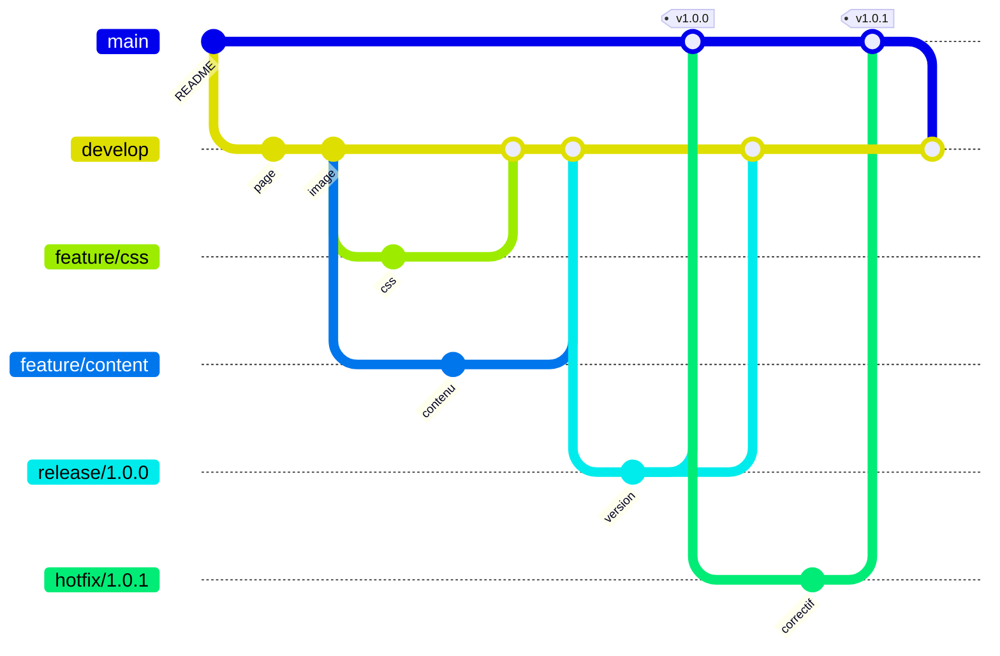
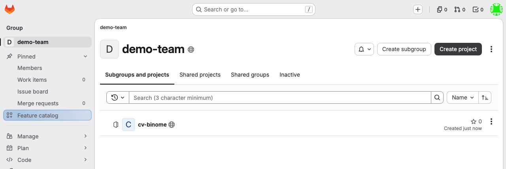
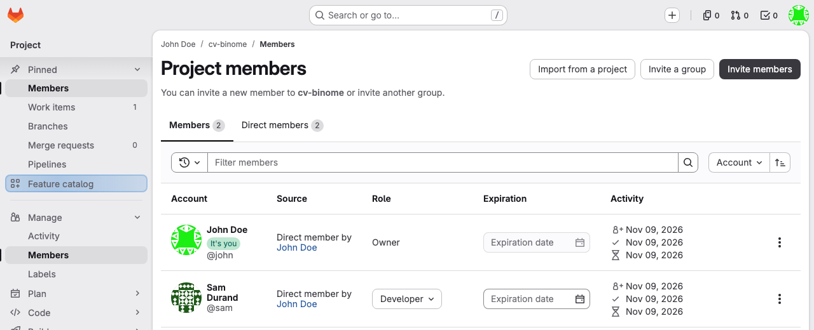
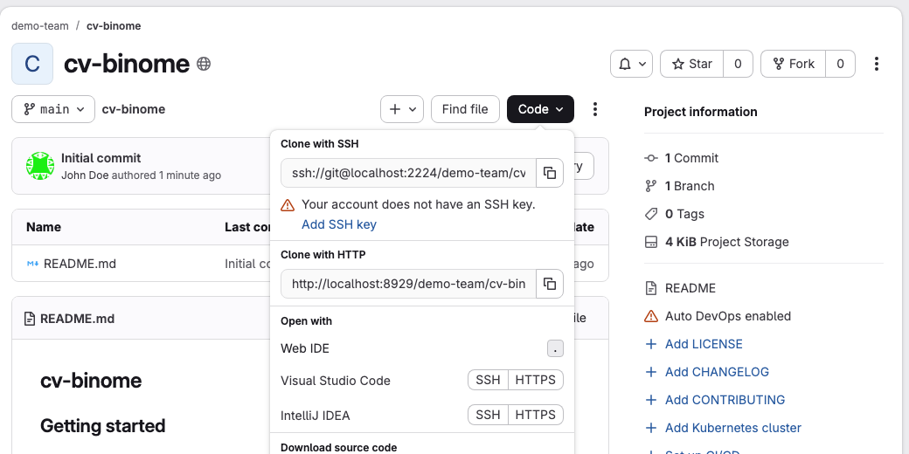

Voici le trajet complet que suivra votre projet. :



## 01.1 - 🟦 Dev. A : créer le projet

> 🟦 **Dev. A (manager)**, sur gitlab.com.

Sur GitLab, un projet vit dans votre espace personnel ou dans un **groupe**, qui rassemble plusieurs projets et leurs membres. Pour ce lab, votre espace personnel suffit. Si vous utilisez un groupe, le bouton **Create project** se trouve sur sa page :



Cliquez sur le **+** en haut de page, puis sur **New project/repository**, et enfin sur **Create blank project**. Remplissez ensuite le formulaire :

1. dans **Project name**, saisissez `cv-binome` ;
2. dans **Project URL**, choisissez votre nom d'utilisateur ;
3. dans **Visibility Level**, choisissez **Public** ;
4. laissez cochée la case **Initialize repository with a README** ;
5. cliquez sur **Create project**.

Le projet est créé avec un commit et une branche `main`.

Une fois le projet créé, confirmez pour continuer.

```acknowledge
Le projet cv-binome est créé
```

## 01.2 - 🟦 Dev. A : inviter dev. B avec le rôle Developer

> 🟦 **Dev. A (manager)**, sur gitlab.com. Seul, passez cette section.

Un **rôle** définit ce qu'un membre peut faire sur le projet. Vous en êtes **Owner**, car vous l'avez créé. Ce lab utilise surtout la différence entre deux niveaux :

| Rôle | Ce qu'il permet ici |
|---|---|
| **Developer** | pousser ses branches de travail, et proposer des merge requests, c'est-à-dire des demandes de fusion |
| **Maintainer** | en plus, pousser sur les branches protégées, c'est-à-dire réservées à certains rôles, fusionner, et régler le projet |
| **Owner** | les droits de Maintainer, et en plus supprimer le projet |

Dans le menu du projet, ouvrez **Manage**, puis **Members**, et cliquez sur **Invite members** :



Demandez à dev. B son nom d'utilisateur GitLab, visible sur son profil. Saisissez-le dans le champ **Email addresses or GitLab usernames**. Choisissez le rôle **Developer**, puis cliquez sur **Invite**.

> 💡 **Remarque.** Vous pouvez aussi inviter un membre sur un groupe entier. Il obtient alors le même rôle sur tous les projets de ce groupe.

Confirmez lorsque l'invitation est envoyée.

```acknowledge
Dev. B est invité avec le rôle Developer, ou je fais ce lab seul
```

## 01.3 - 🟦 Dev. A : cloner le projet dans dev-a

> 🟦 **Dev. A (manager)**, sur gitlab.com puis sur son environnement, dans le terminal.

Sur la page du projet, cliquez sur le bouton **Code** et copiez l'adresse **Clone with HTTPS**. Ce lab utilise HTTPS, car il ne demande aucune configuration de clé SSH. Cette capture vient d'un serveur de test, et sur gitlab.com l'adresse commence bien par `https://` :



Enregistrez cette adresse dans un fichier, en remplaçant l'exemple par la vôtre. Les vérifications du lab le liront :

```bash
mkdir -p ~/layers-git/binome
echo 'https://gitlab.com/votre-nom/cv-binome.git' > ~/layers-git/binome/url
```

Clonez ensuite le projet dans le dossier `dev-a` :

```exec
cd ~/layers-git/binome && git clone "$(cat url)" dev-a
```

Transmettez ensuite l'adresse de `url` à dev. B, qui en a besoin à la section suivante.

```verify
C=$(cat ~/layers-git/binome/url 2>/dev/null)
if [ -z "$C" ]; then
  echo "L'adresse du projet n'est pas enregistrée dans ~/layers-git/binome/url."
  exit 1
fi
H=$(echo "$C" | sed -E 's#^(https?://)([^/@]*@)?([^/]+)/.*#\1\3#')
P=$(echo "$C" | sed -E 's#^https?://[^/]+/##; s#\.git$##; s#/#%2F#g')
A="$H/api/v4/projects/$P"
if ! curl -fsS "$A" 2>/dev/null | grep -q '"visibility":"public"'; then
  echo "Le projet est introuvable ou n'est pas public. Vérifiez l'adresse dans ~/layers-git/binome/url et sa visibilité."
  exit 1
fi
if [ ! -d ~/layers-git/binome/dev-a/.git ] && [ ! -d ~/layers-git/binome/dev-b/.git ]; then
  echo "Le dossier du clone n'existe pas encore dans ~/layers-git/binome."
  exit 1
fi
echo "Le projet est public, et il est cloné."
```

➡️ **Au tour de 🟧 dev. B** : section 01.4. Dev. A, vous pouvez continuer avec l'étape 02.

## 01.4 - 🟧 Dev. B : cloner le projet dans dev-b

> 🟧 **Dev. B**, sur son environnement, dans le terminal. Seul, passez directement à la commande `git clone`.
>
> ⏳ **Attendez** que dev. A vous ait invité (section 01.2) et transmis l'adresse (section 01.3).

Acceptez l'invitation si GitLab vous l'envoie par e-mail. Enregistrez ensuite l'adresse que dev. A vous a transmise :

```bash
mkdir -p ~/layers-git/binome
echo 'https://gitlab.com/nom-de-dev-a/cv-binome.git' > ~/layers-git/binome/url
```

Clonez le projet dans le dossier `dev-b`, puis regardez ce qu'il contient :

```exec
cd ~/layers-git/binome && git clone "$(cat url)" dev-b
cd ~/layers-git/binome/dev-b && ls
```

**Seul**, donnez à ce second dossier une autre identité, pour distinguer les deux personnes dans l'historique :

```bash
cd ~/layers-git/binome/dev-b && git config user.name "Dev B" && git config user.email "dev.b@example.com"
```

```verify
C=$(cat ~/layers-git/binome/url 2>/dev/null)
if [ -z "$C" ]; then
  echo "L'adresse du projet n'est pas enregistrée dans ~/layers-git/binome/url."
  exit 1
fi
H=$(echo "$C" | sed -E 's#^(https?://)([^/@]*@)?([^/]+)/.*#\1\3#')
P=$(echo "$C" | sed -E 's#^https?://[^/]+/##; s#\.git$##; s#/#%2F#g')
A="$H/api/v4/projects/$P"
if [ ! -d ~/layers-git/binome/dev-b/.git ] && [ ! -d ~/layers-git/binome/dev-a/.git ]; then
  echo "Le dossier du clone n'existe pas encore dans ~/layers-git/binome."
  exit 1
fi
if ! curl -fsS "$A" 2>/dev/null | grep -q '"visibility":"public"'; then
  echo "Le projet est introuvable. Vérifiez l'adresse dans ~/layers-git/binome/url."
  exit 1
fi
echo "Vous avez votre clone du projet."
```

➡️ **Dev. B, patientez** : dev. A prépare la suite, jusqu'à la section 02.3.

> 📖 [Rôles et permissions](https://docs.gitlab.com/user/permissions/) · [Tokens d'accès personnels](https://docs.gitlab.com/user/profile/personal_access_tokens/)
