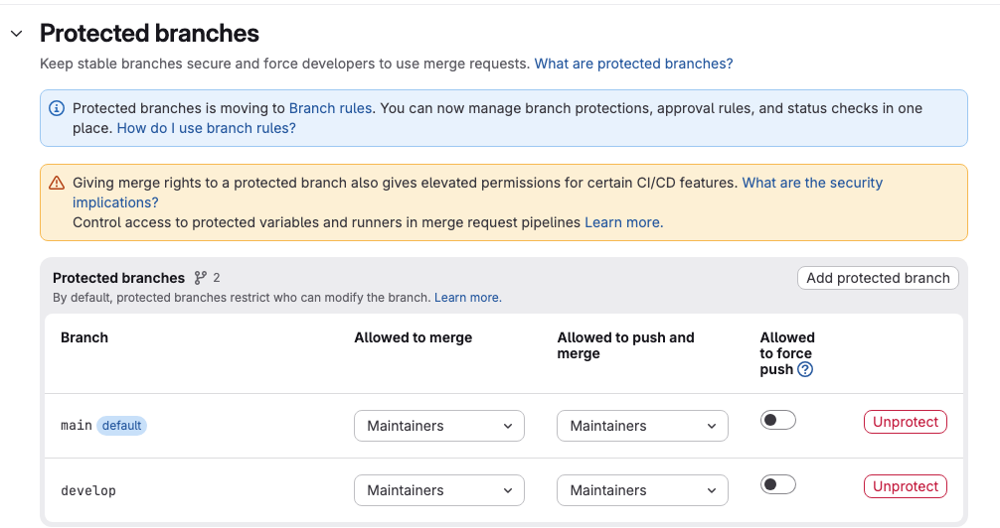

L'échauffement comporte un risque : n'importe quel membre peut pousser sur `develop`, sans que personne ne relise. Une **branche protégée** règle ce problème, car GitLab n'y accepte que les personnes autorisées. Voici ce que chacun pourra faire à partir de maintenant :

| | Pousser sur `main` ou `develop` | Pousser une branche de travail | Fusionner vers `main` ou `develop` |
|---|---|---|---|
| 🟦 **Dev. A**, Owner | oui | oui | oui |
| 🟧 **Dev. B**, Developer | non | oui | non |

Seul, votre compte unique reste Owner : ce tableau décrit donc ce que ferait un vrai dev. B.

## 03.1 - 🟦 Dev. A : protéger develop

> 🟦 **Dev. A (manager)**, sur gitlab.com.

GitLab protège déjà `main`, la branche par défaut du projet. Il reste à protéger `develop`. Dans le menu du projet, ouvrez **Settings**, puis **Repository**, et dépliez **Protected branches**. Cliquez sur **Add protected branch** :



Remplissez le formulaire comme ceci, puis validez avec **Protect** :

| Champ | Valeur |
|---|---|
| **Branch** | `develop` |
| **Allowed to merge** | **Maintainers** |
| **Allowed to push and merge** | **Maintainers** |

Un Owner a au moins les droits d'un Maintainer. Vous restez donc autorisé.

```verify
C=$(cat ~/byte-layers/git/binome/url 2>/dev/null)
if [ -z "$C" ]; then
  echo "L'adresse du projet n'est pas enregistrée dans ~/byte-layers/git/binome/url."
  exit 1
fi
H=$(echo "$C" | sed -E 's#^(https?://)([^/@]*@)?([^/]+)/.*#\1\3#')
P=$(echo "$C" | sed -E 's#^https?://[^/]+/##; s#\.git$##; s#/#%2F#g')
A="$H/api/v4/projects/$P"
for B in main develop; do
  if ! curl -fsS "$A/repository/branches/$B" 2>/dev/null | grep -q '"protected":true'; then
    echo "La branche $B n'est pas protégée."
    exit 1
  fi
done
if curl -fsS "$A/repository/branches/develop" 2>/dev/null | grep -qE '"developers_can_(push|merge)":true'; then
  echo "Les Developers ont encore des droits sur develop. Réglez les deux champs sur Maintainers."
  exit 1
fi
echo "main et develop sont protégées."
```

➡️ **Au tour de 🟧 dev. B** : section 04.2. Dev. A, continuez en même temps avec la section 04.1.

> 📖 [Branches protégées](https://docs.gitlab.com/user/project/repository/branches/protected/)
